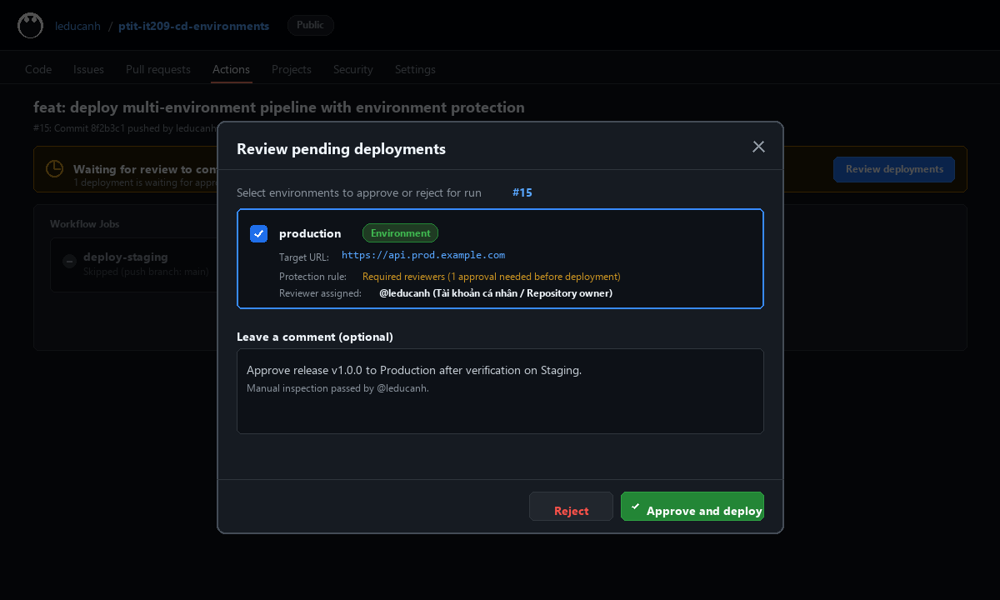

# Bài 3: Tách biệt luồng CI/CD đa môi trường (Staging & Production) với GitHub Environments

## 1. Mục tiêu
- Quản lý hạ tầng triển khai đa môi trường (**Staging** vs **Production**) thông qua tính năng **GitHub Environments**.
- Cấu hình **Environment Protection Rules** yêu cầu phê duyệt thủ công (**Manual Approval / Required Reviewers**) trước khi mã nguồn được phép deploy lên môi trường Production.
- Tự động hóa điều hướng deployment theo nhánh mã nguồn:
  - Nhánh `develop`: Tự động deploy sang môi trường `staging`.
  - Nhánh `main`: Dừng chờ phê duyệt thủ công trước khi deploy sang môi trường `production`.

---

## 2. Hướng dẫn cấu hình trên GitHub Repository

### Bước 1: Khởi tạo 2 môi trường (Staging & Production)
1. Trên GitHub Repository, truy cập: **Settings** -> **Environments**.
2. Nhấn **New environment** và tạo lần lượt 2 môi trường:
   - `staging`
   - `production`

### Bước 2: Thiết lập Environment Protection Rules cho môi trường Production
1. Tại danh sách Environments, chọn môi trường **production**.
2. Trong mục **Deployment branches and tags**, giới hạn chỉ cho phép triển khai từ nhánh `main`.
3. Trong mục **Environment protection rules**, tích chọn **Required reviewers**.
4. Tìm và thêm tài khoản cá nhân (Repository owner: `@leducanh`) làm người phê duyệt bắt buộc.
5. Nhấn **Save protection rules**.

---

## 3. Cấu hình kịch bản Workflow (`.github/workflows/cd-multi-env.yml`)

```yaml
name: Multi-Environment CD Pipeline

on:
  push:
    branches:
      - main
      - develop
  workflow_dispatch:

jobs:
  deploy-staging:
    name: Deploy to Staging
    if: github.ref == 'refs/heads/develop'
    runs-on: ubuntu-latest
    environment:
      name: staging
      url: https://api.staging.example.com
    steps:
      - name: Checkout mã nguồn
        uses: actions/checkout@v4

      - name: Triển khai ứng dụng lên Staging
        run: |
          echo "Triển khai phiên bản thử nghiệm lên môi trường Staging..."
          echo "Endpoint URL: https://api.staging.example.com"
          echo "Deployment to Staging completed successfully!"

  deploy-prod:
    name: Deploy to Production
    if: github.ref == 'refs/heads/main'
    runs-on: ubuntu-latest
    environment:
      name: production
      url: https://api.prod.example.com
    steps:
      - name: Checkout mã nguồn
        uses: actions/checkout@v4

      - name: Triển khai ứng dụng lên Production
        run: |
          echo "Triển khai phiên bản chính thức lên môi trường Production..."
          echo "Endpoint URL: https://api.prod.example.com"
          echo "Deployment to Production completed successfully!"
```

---

## 4. Ảnh chụp màn hình cửa sổ phê duyệt Deployment môi trường Production



---

## 5. Quy trình kiểm tra & Cơ chế hoạt động

1. **Triển khai nhánh develop (Staging)**:
   - Khi commit/push vào nhánh `develop`, Job `deploy-staging` kích hoạt.
   - Job thực thi tự động, không yêu cầu phê duyệt và trả về tích xanh (Success).

2. **Triển khai nhánh main (Production)**:
   - Khi push vào nhánh `main`, Job `deploy-prod` được kích hoạt.
   - Do môi trường `production` có cấu hình Protection Rule **Required reviewers**, GitHub Actions lập tức tạm dừng luồng chạy tại bước `deploy-prod` với thông báo:
     > **Waiting for review**: *1 deployment is waiting for approval from required reviewers before proceeding.*
   - Người phụ trách (`@leducanh`) nhận được thông báo review.
   - Mở modal **Review pending deployments**, tích chọn môi trường `production`, nhập ghi chú phê duyệt và nhấn nút **Approve and deploy**.
   - Ngay sau khi được phê duyệt, Job tiếp tục chạy và hoàn tất với trạng thái tích xanh.
